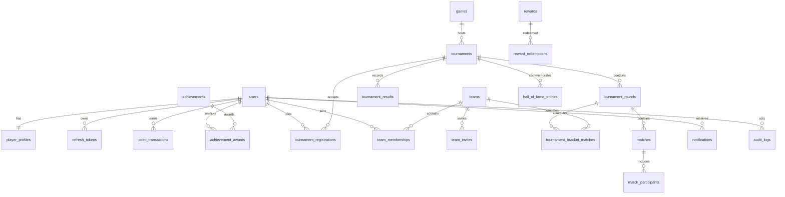

# API notes

Interactive OpenAPI is served at `/docs`. List endpoints use `{items,total,limit,offset}`; the frontend helper unwraps `items` for current list screens. Errors use `{error:{code,message,details}}`. Auth uses `POST /auth/token` with OAuth2 form fields `username` and `password`, returns short lived access plus rotatable refresh tokens, and includes `/auth/register`, `/auth/refresh`, `/auth/logout`, `/auth/me`, password change, and reset request.

Public reads: players, tournament discovery/results, leaderboards, published achievements, announcements, videos, and hall of fame. Login is required for profile updates, registration, teams, rewards, and notifications. Admin-only writes are guarded by role dependencies. Admin actions write audit records.

Available paths include `/players/`, `/players/{id}`, `/players/{id}/stats`, `/players/{id}/points`, `/players/{id}/results`, `/players/compare?ids=id1,id2`, `/tournaments/`, tournament detail/register/participants/results, authenticated `GET /tournaments/{id}/my-registration`, `/tournaments/{id}/teams/leaderboard?limit=10&offset=0`, `/tournaments/{id}/bracket`, `/teams/`, `/leaderboard/{period}`, `/achievements/`, `/rewards/`, `/notifications/`, `/announcements/`, `/videos/`, `/hall-of-fame/`, `/search?q=...`, and `/admin/*` management operations.

For team tournaments, the event team leaderboard sums the current point balances of the active registered members of each team. The results tab displays persisted single-elimination rounds. Admins generate the bracket with `POST /admin/tournaments/{id}/bracket/generate` and `{ "team_ids": ["..."] }`; choose at least two teams, each with an active registration, exactly once. Admins submit scores with `POST /admin/tournaments/{id}/bracket/matches/{match_id}/result` and `{ "winner_team_id": "...", "score1": 2, "score2": 1 }`. Power-of-two byes advance automatically. Final match completion awards each active registered member of bracket teams according to the documented placement schedule and completes the tournament.

Leaderboard tie order: persisted points descending, tournament wins descending, earliest point achievement ascending, then UUID ascending for deterministic output. Results award +500/+300/+200 to placements one/two/three, +100 to other classified players, and +50 participation. Equal placements get the same placement points. Result corrections append reversal entries before applying corrected awards.

## Schema overview

All tables have RLS enabled with no anon/authenticated policies. API traffic uses backend privileged DB connection only. Point transactions have a PostgreSQL trigger rejecting updates/deletes; fixups are compensating entries.
